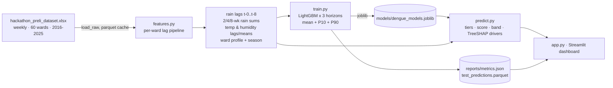

# Architecture — Dengue Early-Warning System (Stage 1)

## 1. Data flow

Plain-text version: `xlsx → parquet cache → lag features → train (offline) → joblib → predict → dashboard`.
Training is offline and runs once (~25 s on 1 CPU); the dashboard only does inference.

## 2. Weather-lag pipeline (`src/features.py`)

The brief's "breeding clock" (7–14 days of larval maturation + viral incubation + symptom onset ⇒ 2–4 week rain→cases lag) is encoded explicitly, per ward (`groupby("ward_id")`, so lags never cross wards):

- Rainfall at `t-0 … t-8` weeks, rolling sums over 2/4/8 weeks, weeks 3–5 accumulation, and `rain_sum_4w × water_logging_risk_index`.
- Temperature (avg lag 0/2/4, 4-week mean, 4-week min-temp mean) and humidity (same).
- Ward vulnerability: `population_density_sqkm`, `water_logging_risk_index`, `sanitation_score`, city code.
- Seasonality: sine/cosine of ISO week.
- Targets: cases at `t+2`, `t+3`, `t+4` weeks (`y_h2/3/4`), built with a forward shift. Inputs only use data ≤ `t`.

Data check that motivated this: correlation between rainfall at lag *k* weeks and cases peaks at **k = 3 (r = 0.75)** versus 0.53 at lag 0.

## 3. Chronological validation (no shuffling, no leakage)

| Split | Period | Use |
|---|---|---|
| Train | 2016-01 → 2022-12 | fit models; tier cut-offs and score ECDF are computed **only from here** |
| Validation | 2023 | early stopping (number of trees) |
| Test | 2024-01 → 2025-12 | reported once, never used for any decision |

`tests/test_pipeline.py` verifies lag correctness, that targets are strictly future values, and that altering future weather does not change past features.
A production refit on all data is available with `python -m src.train --refit-all`.

## 4. Model selection rationale

- **LightGBM (Poisson objective)**: dengue cases are non-negative counts (58 % zeros) and the weather→cases relation is non-linear with interactions (rain × waterlogging × season). Gradient-boosted trees handle this on 31k rows with seconds of training, tiny CPU cost, native NaN handling and **native TreeSHAP** (`pred_contrib`) for the driver breakdown — no extra dependency.
- **One model per lead time (2, 3, 4 weeks)** instead of one model with a horizon feature: each lead has a different dominant lag, and per-horizon models stay simple to explain.
- **P10/P90 quantile models** provide the forecast band.
- **Risk tiers are data-derived**: Low / Medium / High / Critical = below the 60th / 85th / 95th percentile of historical weekly ward cases (cut-offs ≈ 1 / 7 / 13 cases per week). Risk score = percentile rank (0–100) of predicted cases.
- Two variants are shipped: **weather-only** (default, matches the brief) and **weather + recent reported cases**. Adding case history gave no measurable gain (MAE 1.04 vs 1.04 at 3 weeks), which supports the claim that rainfall lags carry the signal.

### Held-out test results (2024–2025, weather-only model)

| Lead | MAE | RMSE | Seasonal-climatology MAE | Tier accuracy | Within ±1 tier | High+ alert recall / precision |
|---|---|---|---|---|---|---|
| 2 wk | 1.02 | 2.02 | 1.27 | 0.79 | 0.99 | 0.71 / 0.68 |
| 3 wk | 1.04 | 2.00 | 1.28 | 0.78 | 1.00 | 0.71 / 0.67 |
| 4 wk | 1.20 | 2.30 | 1.29 | 0.76 | 0.99 | 0.71 / 0.60 |

Known limitations: exact "Critical" recall is low (~20–25 %, mostly misclassified as High) because a mean-regression model under-predicts the extreme tail of noisy counts; the 4-week lead is only modestly better than the seasonal baseline; the P10–P90 band is conservative (≈95 % empirical coverage); results come from one dataset, so performance should be re-validated on real surveillance data before operational use.

## 5. Compute & API cost controls

- **Zero external API calls and zero LLM calls** in training and inference; all weather comes from the supplied table. Nothing can loop on a paid API.
- Raw xlsx parsed once → `data/processed.parquet` (≈3 s → ≈0.03 s per load).
- Models serialised with `joblib` and loaded once per process (`functools.lru_cache` / `st.cache_resource`); no retraining at request time.
- Lag features for all 31k ward-weeks computed once per session (`st.cache_data`); city-level forecasts are cached per (variant, city, origin).
- Inference for a ward is three small tree-ensemble calls (milliseconds); a whole city (≤ 20 wards) is one vectorised call.
- What-if scenarios recompute features for a single ward's last 24 weeks only.
- Extension path for Stage 2 (documented, not implemented): fetch live forecasts from a weather API **once per city per day** (not per ward), store them on disk with a TTL, and let every ward reuse that cached response.
