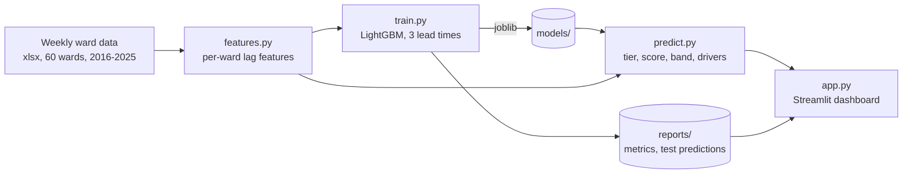

# 🦟 Dengue Early-Warning System

**Weather-lag driven, ward-level dengue risk forecasts, 2–4 weeks ahead.**
Built for the _AI for Urban Dengue Outbreak_ hackathon (Phase 1, 24-hour remote qualifier).

City corporations usually spray and clear drains only after hospital admissions climb, when transmission is already weeks ahead. This system uses rainfall, temperature and humidity to flag high-risk wards **before** the outbreak peaks, so officers can target larvicide and cleaning teams early.

> 📹 **Demo video:** _add link here_ · 🖼️ **Screenshot:** add `docs/dashboard.png` and uncomment the line below
>
> <!--  -->

---

## Table of contents

1. [Key features](#key-features)
2. [Quick start](#quick-start)
3. [Using the dashboard](#using-the-dashboard)
4. [How it works](#how-it-works)
5. [Results](#results)
6. [Project structure](#project-structure)
7. [Reproducibility and tests](#reproducibility-and-tests)
8. [Compute and cost efficiency](#compute-and-cost-efficiency)
9. [Limitations and next steps](#limitations-and-next-steps)
10. [AI disclosure](#ai-disclosure)
11. [Team](#team)

---

## Key features

- **Multi-week weather lag pipeline.** Rainfall at t‑0 … t‑8 weeks, 2/4/8‑week rainfall totals, temperature and humidity lags, built per ward so lags never cross wards. This matches the mosquito breeding clock: in this dataset rainfall correlates most strongly with cases **3 weeks later** (r ≈ 0.75, versus ≈ 0.53 for same‑week rain).
- **Trained model, not rules.** LightGBM (Poisson objective) with one model per lead time (2, 3 and 4 weeks), plus 10th/90th percentile models for a forecast band.
- **Clear risk tiers.** Low / Medium / High / Critical, cut at the 60th / 85th / 95th percentile of historical weekly ward cases (training years only), plus a 0–100 risk score.
- **Explains itself.** A driver chart (LightGBM TreeSHAP) shows whether rainfall, temperature, humidity, ward vulnerability or season is pushing a ward's risk up or down.
- **Interactive dashboard (Streamlit).** Ward forecast, **what‑if rainfall slider**, city‑wide ward ranking and **ward × week heatmap**, and a **chronological validation dashboard** (MAE / RMSE).
- **Cheap to run.** No external API calls, no LLM calls. Models are saved with `joblib` and loaded once; features are cached.

## Quick start

**Requirements:** Python 3.10 – 3.12, Git. Runs on Windows, macOS and Linux. Setup takes about 2 minutes.

```bash
git clone https://github.com/ShuvankarDG/Hackathon.git
cd <your-repo-folder>

python -m venv .venv
```

Activate the virtual environment:

| OS                   | Command                      |
| -------------------- | ---------------------------- |
| Windows (PowerShell) | `.venv\Scripts\Activate.ps1` |
| macOS / Linux        | `source .venv/bin/activate`  |

Then:

```bash
python -m pip install -r requirements.txt
python -m streamlit run app.py
```

The dashboard opens at <http://localhost:8501>. Trained models and validation reports are included in the repo, so you do **not** need to train first.

**Optional commands**

| Task                                                           | Command                                                      |
| -------------------------------------------------------------- | ------------------------------------------------------------ |
| Retrain all models (about 30 s on one CPU)                     | `python -m src.train`                                        |
| Production refit on all data (no honest test score afterwards) | `python -m src.train --refit-all`                            |
| Run the tests                                                  | `python -m pytest -q`                                        |
| Forecast one ward in the terminal                              | `python -m src.predict --ward CCC_Ward_01 --date 2025-07-07` |

**Troubleshooting**

- _PowerShell blocks activation:_ run `Set-ExecutionPolicy -Scope Process -ExecutionPolicy RemoteSigned`, then activate again.
- _`streamlit` not recognised:_ use `python -m streamlit run app.py`.
- _`KeyError: 'variants'`:_ the saved model is from an older training script. Run `python -m src.train` once.
- _Port in use:_ add `--server.port 8502`.

## Using the dashboard

1. In the sidebar choose a **city**, **ward** and **forecast week** (the week "today" is in the data).
2. **🎯 Ward forecast:** the risk tier and score for the 2–4 week window, a weekly forecast with a P10–P90 band, and the main weather drivers. Move the **rainfall slider** (0×–2×) to see how the tier changes if recent rain were lower or higher.
3. **🗺️ City ward ranking & heatmap:** every ward in the city ranked for weeks +2 to +4, with a ward × week heatmap.
4. **📉 Model validation:** error versus a seasonal baseline on years the model never saw, plus tier accuracy and alert recall/precision.
5. The sidebar **model** switch compares the weather‑only model with one that also uses recent reported cases.

## How it works



- **Inputs:** `avg_temp_c`, `rainfall_mm`, `relative_humidity_pct`, ward profile (`population_density_sqkm`, `water_logging_risk_index`, `sanitation_score`) and season.
- **Targets:** weekly cases 2, 3 and 4 weeks after the forecast week.
- **Chronological split (no shuffling):** train 2016–2022 · validation 2023 (early stopping) · test 2024–2025 (reported once).
- **No leakage:** every input uses data up to the forecast week only; tier cut-offs and the risk-score distribution come from training years only. Tests enforce this.

Full design, model rationale and cost controls: **[ARCHITECTURE.md](ARCHITECTURE.md)**.

## Results

Held-out test years 2024–2025, weather‑only model:

| Lead time | MAE  | RMSE | Seasonal‑baseline MAE | Tier accuracy | Within ±1 tier | High+ alert recall / precision |
| --------- | ---- | ---- | --------------------- | ------------- | -------------- | ------------------------------ |
| 2 weeks   | 1.02 | 2.02 | 1.27                  | 0.79          | 0.99           | 0.71 / 0.68                    |
| 3 weeks   | 1.04 | 2.00 | 1.28                  | 0.78          | 0.99           | 0.71 / 0.67                    |
| 4 weeks   | 1.20 | 2.30 | 1.29                  | 0.76          | 0.99           | 0.71 / 0.60                    |

MAE is in cases per ward per week. Adding recent reported cases did not improve accuracy, which supports the idea that rainfall lags carry the signal.

## Project structure

```
.
├── app.py                  Streamlit dashboard
├── src/
│   ├── features.py         data loading and multi-week lag features
│   ├── train.py            chronological training and evaluation
│   ├── predict.py          inference, tiers, drivers, what-if
│   └── risk.py             tier cut-offs and risk score
├── models/                 serialized models (joblib)
├── reports/                metrics.json, test_predictions.parquet
├── tests/                  lag-correctness and leakage tests
├── data/                   provided dataset
├── ARCHITECTURE.md         design, validation split, model rationale, cost controls
├── requirements.txt
└── README.md
```

## Reproducibility and tests

- Fixed random seed (42) and a pinned chronological split, so retraining gives the same numbers.
- `python -m pytest -q` runs four tests: lags equal the raw shifted weather, targets are strictly future cases, changing future weather does not change past features, and forecasts are valid tiers.

## Compute and cost efficiency

- **Zero external API calls and zero LLM calls** in training and inference. Nothing can loop on a paid service.
- The Excel file is parsed once and cached as Parquet (about 3 s to 0.03 s per load).
- Models are serialized with `joblib` and loaded once per process; nothing is retrained at request time.
- Features for all ward‑weeks are computed once per session; city forecasts are one vectorised call.
- Stage‑2 idea: fetch a live weather forecast **once per city per day**, cache it on disk and share it across wards.

## Limitations and next steps

- Exact **Critical** weeks are often predicted as **High**, because a model of average cases under‑predicts extreme weeks. About 71 % of High+ weeks are caught.
- The 4‑week forecast is only modestly better than the seasonal baseline.
- The P10–P90 band is conservative (about 95 % empirical coverage on the test years).
- Results come from one dataset; re‑validate on real surveillance data before operational use.
- Next: live weather ingestion with caching, a geographic ward map (needs ward coordinates), and a FastAPI service so other apps can request forecasts.

## AI disclosure

- **AI assistants used:** Claude (Anthropic) helped design the pipeline and write code, tests and documentation. _Add any other AI tools your team used (for example ChatGPT, Copilot)._
- **External APIs used at runtime:** none. The app makes no network calls and no LLM calls.
- **Main libraries:** pandas, NumPy, scikit‑learn, LightGBM, Streamlit, Plotly, joblib, PyArrow, openpyxl.
- **Data:** the dataset supplied by the hackathon organisers.

## Team

| Name | GitHub | Contribution |
| Shuvankar Das Gupta | ShuvankarDG | _e.g. feature pipeline, model training_ |
| Md Ashraf Uddin | ashraf77uddin | _e.g. dashboard , pipeline tests_ |
git 